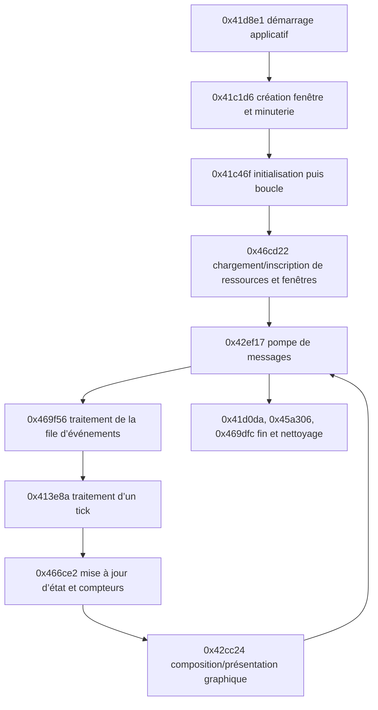

# Carte comportementale statique — première passe

Cette carte relie les comportements visibles dans les pseudocodes Ghidra. Les constats sont des observations statiques ; les descriptions de rôle sont des interprétations à confirmer. Les noms `FUN_...`, les types et les variables globales restent ceux reconstruits ou attribués par Ghidra.

## Chemin d’exécution observé

Les liens de ce schéma correspondent aux appels directs ou aux transferts par thunk visibles dans les dossiers. Les appels indirects par tables de fonctions peuvent cacher des transitions supplémentaires.

## Démarrage et ressources

### Observations Ghidra

- `FUN_0041d8e1` journalise la version `1.16F`, traite la ligne de commande et passe les noms `gamey.txt`, `newtext.txt`, `bldtxt.txt`, `bldname.txt`, `plotobj.txt`, `tonehelp.txt` et `names.txt` à des helpers. Il appelle ensuite l’initialisation fenêtre puis `FUN_0041c46f`.
- `FUN_0041c1d6` appelle `RegisterClassA` avec `Float Class`, crée la fenêtre `Tonus Rebellious`, interroge la fréquence du compteur de performance et contient un chemin conditionnel qui référence `sound.txt` et `DXSOUND`.
- `FUN_0041c46f` charge conditionnellement `data\\logo.gif` et `data\\logo.pal`, appelle `FUN_0046cd22`, puis plusieurs routines d’initialisation. Des chaînes de configuration référencées incluent `windows.txt`, `effects.txt`, `fltinf.txt` et `bldinf.txt`.
- `FUN_0046cd22` appelle des helpers avec `shapes.txt` et `data\\bgoutfnt.fnt`, parcourt des enregistrements, crée des objets pour plusieurs identifiants de fenêtres (dont `GameWindow`, `SceneWindow`, `WorldWindow`, `LoadSaveWindow`, `IWTasks`, `IWTrade`, `IWDiplomacy`, `IWInventory`, `IWSFXList` et `IWUpgrade`). Il référence le diagnostic `Bad Window Type in windows.txt`.

### Interprétation

Le démarrage paraît charger des tables textuelles de localisation/données, des formes et une police, puis bâtir un ensemble de fenêtres de jeu et d’outils. Les fichiers sont maintenant disponibles et comparés aux membres COB dans le corpus local. Les noms référencés par Ghidra établissent un lien au programme, mais le call-site de chaque fichier doit toujours être confirmé avant d’attribuer un parseur précis.

## Fenêtre et événements

### Observations Ghidra

- `FUN_0041c1d6` fournit `LAB_004020d6` comme callback de fenêtre à `RegisterClassA`. L’instruction à `0x4020d6` est un `JMP 0x41bdae`; `FUN_0041bdae` est l’entrée de procédure analysée. Le saut observé n’est pas lui-même une procédure dans l’index Ghidra.
- `FUN_0041bdae` traite `WM_DESTROY` (`0x2`) en appelant `FUN_0041cf86`, qui journalise `Posting Quit Message`, appelle `PostQuitMessage` et met à zéro un état global. Pour `WM_ACTIVATEAPP` (`0x1c`), le callback met à jour des états globaux et déclenche un indicateur de rafraîchissement quand l’application devient active. Le chemin finit par appeler `DefWindowProcA`.
- `FUN_0041be0f` appelle `PeekMessageA`, puis `TranslateMessage` et `DispatchMessageA` quand un message est disponible.
- `FUN_0042ef17` récupère ces messages, arrête son traitement sur `WM_QUIT` (`0x12`), traite séparément certains messages clavier et ajoute d’autres entrées à une file interne.
- `FUN_0042eba0` maintient une file bornée à huit entrées. Son code distingue notamment `WM_MOUSEMOVE` (`0x200`), les touches enfoncées/relâchées (`0x100`/`0x101`) et les boutons gauche/droit (`0x201`, `0x202`, `0x204`, `0x205`), avec coordonnées/modificateurs issus des paramètres de messages.
- `FUN_0042ee48` retire les événements de cette file ; `FUN_00469f56` les consomme et met à jour l’état de fenêtres/focus. Des appels indirects via des tables ou pointeurs de fonctions sont présents.

### Interprétation

La boucle de jeu semble utiliser le pump Win32 comme entrée, puis une file d’événements maison pour transmettre les touches et actions de souris au gestionnaire de fenêtres du jeu. L’ordre exact des événements livrés par chaque classe de fenêtre dépend aussi des appels indirects.

## Mise à jour, rendu et cadence

### Observations Ghidra

- `FUN_0041c46f` boucle tant que `FUN_0042ef17` renvoie `1`. Dans chaque tour, elle traite la file via `FUN_00469f56`, parcourt une collection liée à `DAT_004bf110` et `DAT_004bf114`, puis appelle notamment `FUN_00413e8a`, `FUN_00466ce2` et `FUN_0046bdee`.
- `FUN_00466ce2` appelle plusieurs routines sur des collections d’objets, mesure des durées via `QueryPerformanceCounter` indirectement et met à jour des compteurs/temporisateurs. L’inspection du pseudocode montre aussi des parcours plafonnés à 256 entrées et des tableaux de temporisateurs de 15 éléments ; les rôles métier de ces champs restent à résoudre.
- La boucle contient des branches conditionnelles pour afficher des mesures périodiques, les chaînes comprenant le temps par image/tick, `Cache total` et `Cache buffer`.
- `FUN_0041be72` lit `QueryPerformanceCounter`; `FUN_0041c1d6` mesure `QueryPerformanceFrequency`. La boucle attend ensuite un intervalle dérivé des états globaux avant de présenter l’image.
- `FUN_0042cc24` utilise des appels de méthodes indirects sur des objets de rendu, ainsi que `GetDC`, `ReleaseDC`, `BitBlt`, `GetCursorPos` et `SetCursorPos`. Les erreurs référencées incluent `Flip failed`, `Back to front blit failed` et `BitBlt failed`.
- À la sortie, `FUN_0041c46f` appelle des routines de fermeture, notamment `FUN_0045a306` (libération d’objets par méthodes indirectes), puis `FUN_00469dfc` (parcours et nettoyage d’objets de fenêtres).

### Interprétation

Le chemin observé correspond à une boucle cadencée qui collecte les événements, fait avancer plusieurs objets/états et compose une image. Les chaînes et appels de surface sont compatibles avec une présentation à pages et une voie de copie GDI, mais le type exact des interfaces COM et le rôle métier de chaque objet restent à vérifier.

## Évidence et dossiers sources

| Sujet | Adresse(s) | Evidence ID(s) | Dossier |
|---|---|---|---|
| Entrée applicative | `0x41d8e1` | `ev_4447fdd9631929efaeb1d177248260afbbd55aec3775ce0996e1f9b427cb4e7f` | [application main](functions/0002_application_main.md) |
| Création de fenêtre | `0x41c1d6` | `ev_b6c592d2020a3b072f7d397ada43d048a75789229d848e76ffadec2a536491cf` | [window init](functions/0003_window_init.md) |
| Boucle principale | `0x41c46f` | `ev_a3a1136454b116409a3a18908d27e23488bf809cdcb8d28b4d4d0805f05688e3` | [main loop](functions/0004_main_loop.md) |
| Fenêtres et formes | `0x46cd22` | `ev_fbdcb9f3b27de341d258e85d68d67d6f9dbe6fb0971f77f99f80d7c8484fa98c` | [window manager initialization](functions/0018_batch_0014.md#fun_0046cd22--0x46cd22) |
| Callback Win32 et fermeture | `0x4020d6 → 0x41bdae → 0x41cf86` | `ev_f59847072eb309e1dd70ee6e13ae354930572914ab05c815aa8a8bd2d573198c`; `ev_4c453f8245e9d1316205dd4285ed187d01ba61dc33a4d464394dc61400095283`; `ev_a96a976ad9c33472b4ef2263c63b0eb7fc71e68f3c288de3c2d861de035fa03b` | [window procedure](functions/0010_batch_0006.md#fun_0041bdae--0x41bdae), [quit request](functions/0010_batch_0006.md#fun_0041cf86--0x41cf86) |
| Pump de messages | `0x41be0f`, `0x42ef17` | `ev_29ad09d456ae628d3158564a8c1dab7a234851e959fde7b086429c419b386514`; `ev_84932651de367bf515bdf073e6673f51992e52b524f7c4d9a416ce8b8a101e83` | [message processing](functions/0010_batch_0006.md#fun_0041be0f--0x41be0f), [loop dispatch](functions/0012_batch_0008.md#fun_0042ef17--0x42ef17) |
| File d’événements | `0x42eba0`, `0x42ee48`, `0x469f56` | `ev_4539fa61c9afdfc26f53f63f89c1eeee1db31de6684e55bec209ac2cf5d040ee`; `ev_b1eef3a6b252c5fa1733dbfcf82a66aff0128de7f09b851e71e222f58035aff9`; `ev_3b7d1c7373d2274d945cf5579c6d5b74b907c2a1517b6587e6a2c23a92bec22e` | [input queue](functions/0012_batch_0008.md#fun_0042eba0--0x42eba0), [window events](functions/0018_batch_0014.md#fun_00469f56--0x469f56) |
| Update et rendu | `0x466ce2`, `0x42cc24`, `0x46bdee` | `ev_b51f2311ff9bd9ad209f0663ea00bfe330e7ff0eff117e8a273292d3112a4e0e`; `ev_29e8acc9ef214546bdb7036b2cbf1e88ffe8105275d37ccc324960fffcdd8da8`; `ev_fa0207968e95f1464cc1c397bc1d8b28d8ffed8238efbbe7a0daf79f16598254` | [update loop](functions/0017_batch_0013.md#fun_00466ce2--0x466ce2), [graphics presentation](functions/0011_batch_0007.md#fun_0042cc24--0x42cc24), [window callback fanout](functions/0018_batch_0014.md#fun_0046bdee--0x46bdee) |

## Prochaines pistes

1. Comparer les parsers aux fichiers présents dans `C:\git\ToneRebellion_Raw\original_content`; les formats de `worldpos.txt`, `pad.txt`, `floater.txt` et `spells.txt` sont maintenant rattachés aux appels/parseurs dans `remake_spec.md`.
2. Relier les codes de la file d’événements aux gestionnaires de fenêtres/classe qui les consomment, y compris les appels indirects.
3. Cartographier les objets manipulés par `FUN_00413e8a` / `FUN_00466ce2` et distinguer simulation, animation, audio et rafraîchissement d’interface.
4. Poursuivre l’initialisation audio à partir du test `sound.txt`/`DXSOUND` et des interfaces appelées conditionnellement.

## Limites

- Aucun fichier `Float.pdb` n’est disponible ; les noms de méthodes et structures restent principalement automatiques.
- Les fichiers de données sont disponibles dans le corpus local et les 483 membres des COB concordent avec leurs copies extraites. Plusieurs tables sont décrites dans `data_catalog.md` et `remake_spec.md`; d’autres parsers et relations aux écrans restent à analyser.
- Les appels virtuels/indirects, les variables globales et les appels calculés peuvent cacher des relations non montrées dans le graphe direct.
- Les données locales sont désormais analysées pour `worldpos.txt`, `pad.txt`, `floater.txt` et `spells.txt`; leurs limites connues et le premier vertical slice du remake figurent dans `remake_spec.md`.
- Aucune exécution du programme n’a été faite ; cette carte décrit le flux statique observé dans Ghidra.
