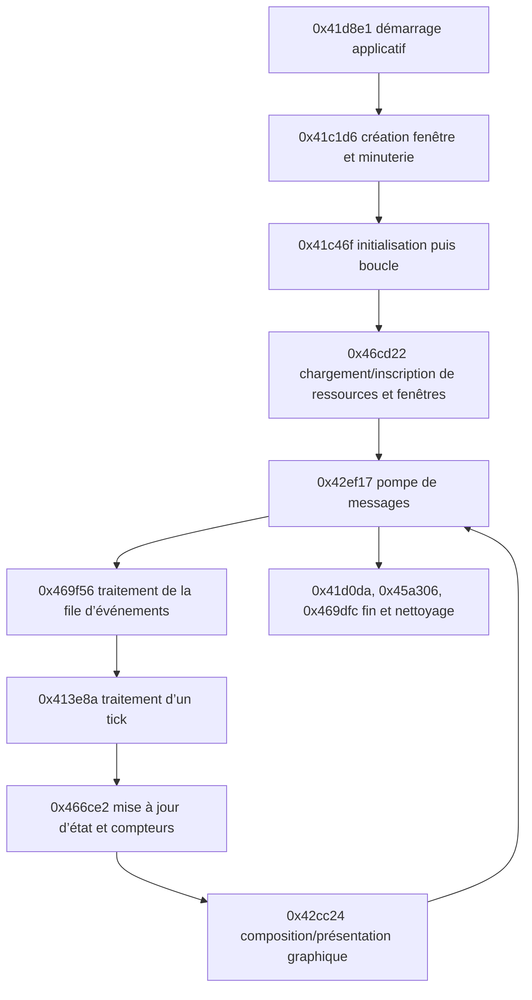

# Carte comportementale statique — première passe

Cette carte relie les comportements visibles dans les pseudocodes Ghidra. Les constats sont des observations statiques ; les descriptions de rôle sont des interprétations à confirmer. Les noms `FUN_...`, les types et les variables globales restent ceux reconstruits ou attribués par Ghidra.

## Chemin d’exécution observé

Les liens de ce schéma correspondent aux appels directs ou aux transferts par thunk visibles dans les dossiers. Les appels indirects par tables de fonctions peuvent cacher des transitions supplémentaires.

## Démarrage et ressources

### Observations Ghidra

- `FUN_0041d8e1` journalise la version `1.16F`, traite la ligne de commande et passe les noms `gamey.txt`, `newtext.txt`, `bldtxt.txt`, `bldname.txt`, `plotobj.txt`, `tonehelp.txt` et `names.txt` à des helpers. Il appelle ensuite l’initialisation fenêtre puis `FUN_0041c46f`.
- `FUN_0041c1d6` appelle `RegisterClassA` avec `Float Class`, crée la fenêtre `Tonus Rebellious`, interroge la fréquence du compteur de performance et contient un chemin conditionnel qui référence `sound.txt` et `DXSOUND`.
- `FUN_0041c46f` charge conditionnellement `data\\logo.gif` et `data\\logo.pal`, appelle `FUN_0046cd22`, puis plusieurs routines d’initialisation. Des chaînes de configuration référencées incluent `windows.txt`, `effects.txt`, `fltinf.txt` et `bldinf.txt`.
- `FUN_0046cd22` appelle des helpers avec `shapes.txt` et `data\\bgoutfnt.fnt`, parcourt des enregistrements, crée des objets pour plusieurs identifiants de fenêtres (dont `GameWindow`, `SceneWindow`, `WorldWindow`, `LoadSaveWindow`, `IWTasks`, `IWTrade`, `IWDiplomacy`, `IWInventory`, `IWSFXList` et `IWUpgrade`). Il référence le diagnostic `Bad Window Type in windows.txt`.

### Interprétation

Le démarrage paraît charger des tables textuelles de localisation/données, des formes et une police, puis bâtir un ensemble de fenêtres de jeu et d’outils. Les fichiers sont maintenant disponibles et comparés aux membres COB dans le corpus local. Les noms référencés par Ghidra établissent un lien au programme, mais le call-site de chaque fichier doit toujours être confirmé avant d’attribuer un parseur précis.

## Fenêtre et événements

### Observations Ghidra

- `FUN_0041c1d6` fournit `LAB_004020d6` comme callback de fenêtre à `RegisterClassA`. L’instruction à `0x4020d6` est un `JMP 0x41bdae`; `FUN_0041bdae` est l’entrée de procédure analysée. Le saut observé n’est pas lui-même une procédure dans l’index Ghidra.
- `FUN_0041bdae` traite `WM_DESTROY` (`0x2`) en appelant `FUN_0041cf86`, qui journalise `Posting Quit Message`, appelle `PostQuitMessage` et met à zéro un état global. Pour `WM_ACTIVATEAPP` (`0x1c`), le callback met à jour des états globaux et déclenche un indicateur de rafraîchissement quand l’application devient active. Le chemin finit par appeler `DefWindowProcA`.
- `FUN_0041be0f` appelle `PeekMessageA`, puis `TranslateMessage` et `DispatchMessageA` quand un message est disponible.
- `FUN_0042ef17` récupère ces messages, arrête son traitement sur `WM_QUIT` (`0x12`), traite séparément certains messages clavier et ajoute d’autres entrées à une file interne.
- `FUN_0042eba0` maintient une file bornée à huit entrées. Son code distingue notamment `WM_MOUSEMOVE` (`0x200`), les touches enfoncées/relâchées (`0x100`/`0x101`) et les boutons gauche/droit (`0x201`, `0x202`, `0x204`, `0x205`), avec coordonnées/modificateurs issus des paramètres de messages.
- `FUN_0042ee48` retire les événements de cette file ; `FUN_00469f56` les consomme et met à jour l’état de fenêtres/focus. Des appels indirects via des tables ou pointeurs de fonctions sont présents.
- Pour le contrôle `IWMove`, `FUN_0044003d` peut émettre `0x32`; `FUN_0042970c` choisit ensuite selon le mode entre callback, file de requêtes et file locale. `FUN_0041c46f` inscrit `FUN_0042fa0f` au slot 3, mais ni le mode 0 ni le slot 3 actif au clic ne sont démontrés. La route vers ce callback reste donc conditionnelle (`ev_dfa9260d630c5590f535d54281a0b8f2c2767e3ca99d4a00ffdd596b3104b7eb`, `ev_196d5ce18818030f061f610add4e421b67b51a08a81cfe4b30f91fd722d4a4dc`, `ev_1a06455495cb08c19a3e95bb1bd8abb4f5f2df731cdd09e809cc8c2a78f504f9`). Voir [contrôles de déplacement](behavior/island-units-and-movement.md).
- Le clic droit de `IWLocInfo` émet aussi `0x3d(1,1)`. Son gestionnaire appelle `FUN_0046c371` avec destinataire `DAT_005c37e4[1]` et message `0x35`; le wrapper appelle indirectement le slot virtuel `+4` de l'objet destinataire quand un état est actif. La classe concrète et l'effet de cette méthode restent inconnus : aucune attribution d'ordre de floater n'est établie (`ev_dfa9260d630c5590f535d54281a0b8f2c2767e3ca99d4a00ffdd596b3104b7eb`, `ev_6ac7cc6650dc8a0e9b412c055606948d1c6dbbdd3e6c6df0a7fcc1551764419e`, `ev_f8a09cad809f94f6483fa8f6623537024026f2d86fdd3f36b90ed39dbda0bd65`).

### Interprétation

La boucle de jeu semble utiliser le pump Win32 comme entrée, puis une file d’événements maison pour transmettre les touches et actions de souris au gestionnaire de fenêtres du jeu. L’ordre exact des événements livrés par chaque classe de fenêtre dépend aussi des appels indirects.

## Mise à jour, rendu et cadence

### Observations Ghidra

- `FUN_0041c46f` boucle tant que `FUN_0042ef17` renvoie `1`. Dans chaque tour, elle traite la file via `FUN_00469f56`, parcourt une collection liée à `DAT_004bf110` et `DAT_004bf114`, puis appelle notamment `FUN_00413e8a`, `FUN_00466ce2` et `FUN_0046bdee`.
- `FUN_00466ce2` appelle plusieurs routines sur des collections d’objets, mesure des durées via `QueryPerformanceCounter` indirectement et met à jour des compteurs/temporisateurs. L’inspection du pseudocode montre aussi des parcours plafonnés à 256 entrées et des tableaux de temporisateurs de 15 éléments ; les rôles métier de ces champs restent à résoudre.
- La boucle contient des branches conditionnelles pour afficher des mesures périodiques, les chaînes comprenant le temps par image/tick, `Cache total` et `Cache buffer`.
- `FUN_0041be72` lit `QueryPerformanceCounter`; `FUN_0041c1d6` mesure `QueryPerformanceFrequency`. La boucle attend ensuite un intervalle dérivé des états globaux avant de présenter l’image.
- `FUN_0042cc24` utilise des appels de méthodes indirects sur des objets de rendu, ainsi que `GetDC`, `ReleaseDC`, `BitBlt`, `GetCursorPos` et `SetCursorPos`. Les erreurs référencées incluent `Flip failed`, `Back to front blit failed` et `BitBlt failed`.
- À la sortie, `FUN_0041c46f` appelle des routines de fermeture, notamment `FUN_0045a306` (libération d’objets par méthodes indirectes), puis `FUN_00469dfc` (parcours et nettoyage d’objets de fenêtres).

### Interprétation

Le chemin observé correspond à une boucle cadencée qui collecte les événements, fait avancer plusieurs objets/états et compose une image. Les chaînes et appels de surface sont compatibles avec une présentation à pages et une voie de copie GDI, mais le type exact des interfaces COM et le rôle métier de chaque objet restent à vérifier.

## Mouvement des entités flottantes

### Observations Ghidra

- `FUN_00466ce2` parcourt les floaters actifs dans la table fixe de 256 slots et appelle `FUN_0041e569` pour leur mise à jour individuelle (`ev_b51f2311ff9bd9ad209f0663ea00bfe330e7ff0eff117e8a273292d3112a4e0e`).
- Dans ce tick, `FUN_0042219e` choisit ou réévalue l'action, tandis que `FUN_004211bb` consomme une action déjà stockée. La réévaluation est appelée à chaque tick quand l'état runtime `+0x2c` vaut 0, sinon à une phase sur dix décalée par l'index du floater (`ev_4c7ea2d2c94eba918c2e82e0709966a1d9d2c60e1d2c705361285aceb05e5dea`, `ev_0e9d3fbfa8df7eb8f372d0b17bc92593ddd6fc2eb7cebe7c043ca611798b4abd`).
- Le pas `FUN_00422d27` lit une destination en coordonnées pixel ou la reconstruit depuis une coordonnée compactée, résout la vitesse à partir des statistiques et de quelques modificateurs, réduit le pas près de la cible et limite X/Y séparément. L'arrivée de son noyau est l'égalité exacte des deux coordonnées (`ev_810f7530a91d83a454c4d310d2142cafe948434cde2b0707fd5847693435b64f`).
- Les états runtime `0x0f` et `0x10` ont une garde d'arrivée par distance de Chebyshev : rayon 10 par défaut, remplacé par la portée d'attaque non nulle renvoyée par `FUN_00420721`; l'action `0x14` impose un rayon nul. La portée est multipliée par 5/4 (division entière) sous une condition de site/bit encore sémantiquement inconnue. L'état runtime `0x0e` utilise plutôt l'arrivée exacte du pas pour décrémenter son minuteur. `FUN_00423068` adapte l'ancre de dessin et le sens; `FUN_0042704b` applique le miroir horizontal au rendu (`ev_6c3ec9c58f2e2ec6ef837d8737ba3dfece6d35c11a918338523e688a6746c25a`, `ev_234f0678b3bbd27430c793e465dfd5095240536d821d1821e23bb5b1acb00e41`, `ev_810f7530a91d83a454c4d310d2142cafe948434cde2b0707fd5847693435b64f`, `ev_3dde3e48aa8d5db8b349dce765fef2704415afc59c5392eaecb900882a0f899f`, `ev_d21d92e7afdc377fecc4fce5fecca40c344273a5e036a4c507b40f99ab2e04b1`).
- `FA_Wander` entre en état runtime `0x0e`; le chemin commun appelle `FUN_00423068`, qui tire deux décalages bornés de `-100..99` autour de la position courante, contraint Y à `0x28..0x122`, puis écrit `+0x28/+0x2a` si X passe le contrôle des limites. La branche sans enregistrement de lieu n'ajoute pas d'offset d'ancre dans cet état. `FUN_00422d27` avance vers cette paire avec pas de base 1; le timer de 60 ticks est décrémenté à l'arrivée exacte, puis l'action peut générer une autre destination. La distribution et la garantie de changement de cible ne sont pas établies. Détails : [mouvement wander](ToneRebellion_Remake/MOVEMENT_REVERSE_ENGINEERING.md#fa_wander-destination-generation-and-repeated-movement) (`ev_96f90fdc7951d5fe26fcf0b495de08970ec0e6984d64572c67ff099abac40957`, `ev_3dde3e48aa8d5db8b349dce765fef2704415afc59c5392eaecb900882a0f899f`, `ev_810f7530a91d83a454c4d310d2142cafe948434cde2b0707fd5847693435b64f`).
- Pour les unités régulières sans action persistante, `FUN_0042219e` peut examiner les 64 enregistrements de tâche, appliquer des gardes et attacher un candidat; si aucun ne passe, un floater sans tâche peut recevoir l'action `FA_Wander` et l'île d'accueil comme cible. Les champs métier de ces enregistrements restent partiellement inconnus.

### Limites et interprétation

Ces fonctions décrivent une mise à jour partagée par les unités, avec sélection d'action, exécution, mouvement et arrivée comme étapes séparées. Le filtre des cibles, les transitions complètes de certaines tâches et la conversion des ticks en secondes restent partiellement reconstruits. Le chemin souris `0x4c` utilise un mode UI et un callback indirect dont le garde destinataire n'est pas identifié; il ne faut donc pas le confondre avec l'attribution autonome des destinations. Le remake porte le noyau de pas et l'orientation, mais pas encore le cycle autonome `FA_Wander` établi par la décompilation. Voir [l'analyse détaillée du mouvement](ToneRebellion_Remake/MOVEMENT_REVERSE_ENGINEERING.md) et [les contrôles de déplacement](behavior/island-units-and-movement.md).

## Création d'une partie et placements initiaux

### Observations Ghidra

- Le dispatch `FUN_004121b7` reçoit les commandes de configuration : type `7` stocke l'indice de taille du monde et type `8` stocke la difficulté. Le type `9` marque la partie démarrée, calcule deux paramètres de génération, appelle `FUN_004637fc` puis ouvre `WORLDVIEW`.
- `FUN_004637fc` sélectionne une table parmi les mondes chargés par `FUN_004642a3`, charge les îles via `FUN_00461b3b`/`FUN_00461859`, réinitialise plusieurs tableaux et appelle `FUN_0046466f` puis `FUN_00464b9e`. Ensuite, les records de classe 2 reçoivent la valeur d'état `2`; la routine distribue aussi des valeurs/liaisons dans des records de classe 0 encore libres. Les noms métier de plusieurs champs et de cette dernière distribution restent inconnus.
- `FUN_00461859`, exécutée après parsing d'une île, copie les trois paramètres de monde associés à l'île, réinitialise plusieurs états de caméra/record via `FUN_004500c4`, rassemble les ponts du monde incidents à cette île et les records de classe 2, puis trie les deux listes avant leur association. Les records de classe 2 excédentaires sont ramenés à la classe 0. Le tri des ponts utilise `FUN_00461768`; le tri des emplacements utilise `FUN_00461831`.
- `FUN_004500c4` met le propriétaire du record à `-1`, efface de nombreux champs runtime, et remet le champ `+0x10` à zéro sauf pour la classe 3. Ceci explique pourquoi les variantes parsées des classes 0/1/2 ne doivent pas être traitées comme des items déjà placés par `FUN_004535e4`.
- `FUN_00461768` compare deux ponts incidents : il trouve pour chacun l'extrémité autre que celle partagée avec l'autre pont, lit les angles de ces extrémités dans la table monde `0x5ebd78`, soustrait les angles et convertit le résultat flottant en entier via `__ftol`. **Interprétation :** ceci ordonne les voisins autour de l'île par angle; la comparaison ne normalise pas explicitement le passage de l'angle zéro.
- `FUN_00461831` compare le premier `short` de deux records de localisation pointés; dans ce contexte les records sont de classe 2 et le champ est leur coordonnée X. Il les trie donc par X croissant.
- `FUN_00467260` obtient le prochain entier 15 bits auprès de `FUN_00474b90`, multiplie par la borne entière, divise par `32768.0f` (constante lue à `0x494798`, octets `00 00 00 47`) et convertit vers zéro par `__ftol`. **Port correspondant :** `ToneRebellion_Remake/src/core/tone_rng.c`; le même générateur alimente maintenant les effets aléatoires du menu.
- `FUN_0046466f` traite quatre slots de joueur. En mode sans bit 0, chaque slot choisit l'île du même indice; les slots pairs marquent le premier record de classe 1 (`tone`) et les slots impairs le quatrième. Le mode alternatif choisit `alternate_island + (slot & 1)` et un ordinal `slot / 2 + 1`.
- `FUN_00464b9e` choisit jusqu'aux cinq premiers marqueurs `tone` de chaque île. Pour les indices 0–3, le principal alterne dernier/premier selon la parité; le bit 0 du mode ajoute l'autre extrémité. Les îles suivantes tirent un marqueur au hasard. `FUN_004535e4` choisit un ID 6–9 selon deux tables indexées par shape ID et les items déjà présents; `FUN_00452859` valide puis `FUN_004528ca` écrit l'ID et le propriétaire. La globale `DAT_006136b0` fixe l'île d'accueil spéciale, mais sa valeur runtime demeure à résoudre. Détails: [distribution des entités de départ](world_start_distribution.md).
- `FUN_00461b3b` compare `pad` à `0x4a4c10` et le classe 0; `tone` à `0x4a4c2c` et le classe 1. Les octets lus par REA à `0x4a4c00` donnent la suite `%d %d %d %s %d\0\0pad\0smpad\0...tone\0\0bridge\0...` (Evidence `ev_346f0482a3c7a5c0cd1c1c4320ec28be7e3b278647786754331652a5a8e798c3`). Ainsi les quatre premiers fichiers du petit monde, qui ont chacun quatre entrées `tone`, fournissent les marqueurs de classe 1 attendus par `FUN_0046466f`.
- À partir du marqueur, `FUN_0046466f` choisit le premier record de classe 0 avec le champ au décalage `+0x10` égal à zéro à distance minimale. `FUN_004672a6` définit cette distance comme `max(abs(dx), abs(dy))`. L'ordre des lignes tranche les égalités. Le code calcule ensuite les bords de caméra horizontaux, crée le pad d'ID `0x2a` à cet emplacement, puis appelle quatre fois `FUN_00462a87` avec le type-index du joueur et la position du marqueur.
- `FUN_00462a87` valide un type-index floater (`0..4`), instancie un objet et initialise sa position/état. `FUN_00452859(0x2a, slot)` crée le pad correspondant; l'ID de ligne 42 dans `pad.txt` décrit `p-hall`/`GREATHALL`, et `FUN_004641de` sélectionne le bloc de 16 items de chaque joueur.

### Portée dans le remake

`ToneRebellion_Remake/src/core/game_start.c` reproduit les sélections d'îles/sites, la règle de distance, le hall `0x2a`, les quatre floaters et les marqueurs/items 6–9. `game_session.c` applique ces résultats à un état runtime mutable, marque les records classe 2 et porte les deux boucles classe 0 de `FUN_004637fc`. Cette initialisation de cœur n'est pas encore branchée à la fenêtre Win32; les interactions/simulation et la sous-phase des IDs `0x17`–`0x19` restent à porter.

## Évidence et dossiers sources

| Sujet | Adresse(s) | Evidence ID(s) | Dossier |
|---|---|---|---|
| Entrée applicative | `0x41d8e1` | `ev_4447fdd9631929efaeb1d177248260afbbd55aec3775ce0996e1f9b427cb4e7f` | [application main](functions/0002_application_main.md) |
| Création de fenêtre | `0x41c1d6` | `ev_b6c592d2020a3b072f7d397ada43d048a75789229d848e76ffadec2a536491cf` | [window init](functions/0003_window_init.md) |
| Boucle principale | `0x41c46f` | `ev_a3a1136454b116409a3a18908d27e23488bf809cdcb8d28b4d4d0805f05688e3` | [main loop](functions/0004_main_loop.md) |
| Fenêtres et formes | `0x46cd22` | `ev_fbdcb9f3b27de341d258e85d68d67d6f9dbe6fb0971f77f99f80d7c8484fa98c` | [window manager initialization](functions/0018_batch_0014.md#fun_0046cd22--0x46cd22) |
| Callback Win32 et fermeture | `0x4020d6 → 0x41bdae → 0x41cf86` | `ev_f59847072eb309e1dd70ee6e13ae354930572914ab05c815aa8a8bd2d573198c`; `ev_4c453f8245e9d1316205dd4285ed187d01ba61dc33a4d464394dc61400095283`; `ev_a96a976ad9c33472b4ef2263c63b0eb7fc71e68f3c288de3c2d861de035fa03b` | [window procedure](functions/0010_batch_0006.md#fun_0041bdae--0x41bdae), [quit request](functions/0010_batch_0006.md#fun_0041cf86--0x41cf86) |
| Pump de messages | `0x41be0f`, `0x42ef17` | `ev_29ad09d456ae628d3158564a8c1dab7a234851e959fde7b086429c419b386514`; `ev_84932651de367bf515bdf073e6673f51992e52b524f7c4d9a416ce8b8a101e83` | [message processing](functions/0010_batch_0006.md#fun_0041be0f--0x41be0f), [loop dispatch](functions/0012_batch_0008.md#fun_0042ef17--0x42ef17) |
| File d’événements | `0x42eba0`, `0x42ee48`, `0x469f56` | `ev_4539fa61c9afdfc26f53f63f89c1eeee1db31de6684e55bec209ac2cf5d040ee`; `ev_b1eef3a6b252c5fa1733dbfcf82a66aff0128de7f09b851e71e222f58035aff9`; `ev_3b7d1c7373d2274d945cf5579c6d5b74b907c2a1517b6587e6a2c23a92bec22e` | [input queue](functions/0012_batch_0008.md#fun_0042eba0--0x42eba0), [window events](functions/0018_batch_0014.md#fun_00469f56--0x469f56) |
| Update et rendu | `0x466ce2`, `0x42cc24`, `0x46bdee` | `ev_b51f2311ff9bd9ad209f0663ea00bfe330e7ff0eff117e8a273292d3112a4e0e`; `ev_29e8acc9ef214546bdb7036b2cbf1e88ffe8105275d37ccc324960fffcdd8da8`; `ev_fa0207968e95f1464cc1c397bc1d8b28d8ffed8238efbbe7a0daf79f16598254` | [update loop](functions/0017_batch_0013.md#fun_00466ce2--0x466ce2), [graphics presentation](functions/0011_batch_0007.md#fun_0042cc24--0x42cc24), [window callback fanout](functions/0018_batch_0014.md#fun_0046bdee--0x46bdee) |
| New game and world setup | `0x4121b7`, `0x4637fc`, `0x461859`, `0x46466f`, `0x4672a6`, `0x462a87`, `0x452859` | `ev_436ec675045ff47701ee7511eba972fb3eac9f707eccb9322fefc66d4be20300`; `ev_96a46390b086f06a56b3c395f6e1a9de7ba2c2a1c30396c7ca72c63944a1039e`; `ev_60cc3b805a032ead183ce15cfa0965bb14b5d6c84b45414f6d11fbbb2eaca75b`; `ev_ac313cb8cc73f9c102676395cd14cb97b5b1f9355d074df1e6656ce028d2d36f`; `ev_d6e45300f5ee5de4ed13ebfa3da2e5198981b6af36bc072d956c795033a50243`; `ev_352feb8e600eceb96c53f7813bd012e104389976cd0dc42358a78b6a0fcddd24`; `ev_a571ddb810f57eb82ddb7110d751957927677498282088ff2bc3d5256611b345` | [function guide](FUNCTION_GUIDE.md#démarrage-dune-partie-et-placement-initial), [command dispatcher](functions/0009_batch_0005.md#fun_004121b7--0x4121b7), [world setup pseudocode](functions/0017_batch_0013.md#fun_004637fc--0x4637fc) |
| Association des ponts d'une île | `0x461859`, `0x461768`, `0x461831`, `0x4777a0`, `0x472c6c` | `ev_60cc3b805a032ead183ce15cfa0965bb14b5d6c84b45414f6d11fbbb2eaca75b`; `ev_0e30ee9ad5fb8589ee58fce47a3a6e4ab0c72e76ca39b0836ffc9a6344f61862`; `ev_b2c053a4bd63d8f7ce191f425358685b35f763313fce9b221df727eef5c30a41`; `ev_a0793f5d9552f14a7accb48cbf992564af87d834ce8fe8c91da7a4cfbdd76ad1` | [bridge matching and comparators](FUNCTION_GUIDE.md#démarrage-dune-partie-et-placement-initial), [bridge setup](functions/0017_batch_0013.md#fun_00461859--0x461859) |

## Prochaines pistes

1. Comparer les parsers aux fichiers présents dans `C:\git\ToneRebellion_Raw\original_content`; les formats de `worldpos.txt`, `pad.txt`, `floater.txt` et `spells.txt` sont maintenant rattachés aux appels/parseurs dans `remake_spec.md`.
2. Relier les codes de la file d’événements aux gestionnaires de fenêtres/classe qui les consomment, y compris les appels indirects.
3. Cartographier les objets manipulés par `FUN_00413e8a` / `FUN_00466ce2` et distinguer simulation, animation, audio et rafraîchissement d’interface.
4. Poursuivre l’initialisation audio à partir du test `sound.txt`/`DXSOUND` et des interfaces appelées conditionnellement.

## Limites

- Aucun fichier `Float.pdb` n’est disponible ; les noms de méthodes et structures restent principalement automatiques.
- Les fichiers de données sont disponibles dans le corpus local et les 483 membres des COB concordent avec leurs copies extraites. Plusieurs tables sont décrites dans `data_catalog.md` et `remake_spec.md`; d’autres parsers et relations aux écrans restent à analyser.
- Les appels virtuels/indirects, les variables globales et les appels calculés peuvent cacher des relations non montrées dans le graphe direct.
- Les données locales sont désormais analysées pour `worldpos.txt`, `pad.txt`, `floater.txt` et `spells.txt`; leurs limites connues et le premier vertical slice du remake figurent dans `remake_spec.md`.
- Aucune exécution du programme n’a été faite ; cette carte décrit le flux statique observé dans Ghidra.
