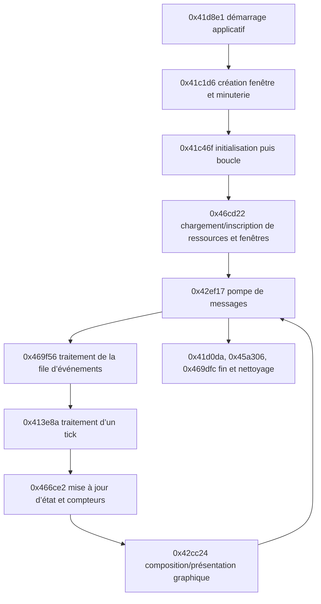

# Carte comportementale statique — première passe

## Chemin d’exécution observé

Les liens de ce schéma correspondent aux appels directs ou aux transferts par thunk visibles dans les dossiers. Les appels indirects par tables de fonctions peuvent cacher des transitions supplémentaires.

---

# Carte comportementale statique — première passe

## Démarrage et ressources

### Observations Ghidra

- `FUN_0041d8e1` journalise la version `1.16F`, traite la ligne de commande et passe les noms `gamey.txt`, `newtext.txt`, `bldtxt.txt`, `bldname.txt`, `plotobj.txt`, `tonehelp.txt` et `names.txt` à des helpers. Il appelle ensuite l’initialisation fenêtre puis `FUN_0041c46f`.
- `FUN_0041c1d6` appelle `RegisterClassA` avec `Float Class`, crée la fenêtre `Tonus Rebellious`, interroge la fréquence du compteur de performance et contient un chemin conditionnel qui référence `sound.txt` et `DXSOUND`.
- `FUN_0041c46f` charge conditionnellement `data\\logo.gif` et `data\\logo.pal`, appelle `FUN_0046cd22`, puis plusieurs routines d’initialisation. Des chaînes de configuration référencées incluent `windows.txt`, `effects.txt`, `fltinf.txt` et `bldinf.txt`.
- `FUN_0046cd22` appelle des helpers avec `shapes.txt` et `data\\bgoutfnt.fnt`, parcourt des enregistrements, crée des objets pour plusieurs identifiants de fenêtres (dont `GameWindow`, `SceneWindow`, `WorldWindow`, `LoadSaveWindow`, `IWTasks`, `IWTrade`, `IWDiplomacy`, `IWInventory`, `IWSFXList` et `IWUpgrade`). Il référence le diagnostic `Bad Window Type in windows.txt`.

### Interprétation

Le démarrage paraît charger des tables textuelles de localisation/données, des formes et une police, puis bâtir un ensemble de fenêtres de jeu et d’outils. Les fichiers sont maintenant disponibles et comparés aux membres COB dans le corpus local. Les noms référencés par Ghidra établissent un lien au programme, mais le call-site de chaque fichier doit toujours être confirmé avant d’attribuer un parseur précis.

---

# Carte comportementale statique — première passe

## Fenêtre et événements

### Observations Ghidra

- `FUN_0041c1d6` fournit `LAB_004020d6` comme callback de fenêtre à `RegisterClassA`. L’instruction à `0x4020d6` est un `JMP 0x41bdae`; `FUN_0041bdae` est l’entrée de procédure analysée. Le saut observé n’est pas lui-même une procédure dans l’index Ghidra.
- `FUN_0041bdae` traite `WM_DESTROY` (`0x2`) en appelant `FUN_0041cf86`, qui journalise `Posting Quit Message`, appelle `PostQuitMessage` et met à zéro un état global. Pour `WM_ACTIVATEAPP` (`0x1c`), le callback met à jour des états globaux et déclenche un indicateur de rafraîchissement quand l’application devient active. Le chemin finit par appeler `DefWindowProcA`.
- `FUN_0041be0f` appelle `PeekMessageA`, puis `TranslateMessage` et `DispatchMessageA` quand un message est disponible.
- `FUN_0042ef17` récupère ces messages, arrête son traitement sur `WM_QUIT` (`0x12`), traite séparément certains messages clavier et ajoute d’autres entrées à une file interne.
- `FUN_0042eba0` maintient une file bornée à huit entrées. Son code distingue notamment `WM_MOUSEMOVE` (`0x200`), les touches enfoncées/relâchées (`0x100`/`0x101`) et les boutons gauche/droit (`0x201`, `0x202`, `0x204`, `0x205`), avec coordonnées/modificateurs issus des paramètres de messages.
- `FUN_0042ee48` retire les événements de cette file ; `FUN_00469f56` les consomme et met à jour l’état de fenêtres/focus. Des appels indirects via des tables ou pointeurs de fonctions sont présents.
- Pour le contrôle `IWMove`, `FUN_0044003d` peut émettre `0x32`; `FUN_0042970c` choisit ensuite selon le mode entre callback, file de requêtes et file locale. `FUN_0041c46f` inscrit `FUN_0042fa0f` au slot 3, mais ni le mode 0 ni le slot 3 actif au clic ne sont démontrés. La route vers ce callback reste donc conditionnelle (`ev_dfa9260d630c5590f535d54281a0b8f2c2767e3ca99d4a00ffdd596b3104b7eb`, `ev_196d5ce18818030f061f610add4e421b67b51a08a81cfe4b30f91fd722d4a4dc`, `ev_1a06455495cb08c19a3e95bb1bd8abb4f5f2df731cdd09e809cc8c2a78f504f9`). Voir [contrôles de déplacement](../behavior/island-units-and-movement.md).
- Le clic droit de `IWLocInfo` émet aussi `0x3d(1,1)`. Son gestionnaire appelle `FUN_0046c371` avec destinataire `DAT_005c37e4[1]` et message `0x35`; le wrapper appelle indirectement le slot virtuel `+4` de l'objet destinataire quand un état est actif. La classe concrète et l'effet de cette méthode restent inconnus : aucune attribution d'ordre de floater n'est établie (`ev_dfa9260d630c5590f535d54281a0b8f2c2767e3ca99d4a00ffdd596b3104b7eb`, `ev_6ac7cc6650dc8a0e9b412c055606948d1c6dbbdd3e6c6df0a7fcc1551764419e`, `ev_f8a09cad809f94f6483fa8f6623537024026f2d86fdd3f36b90ed39dbda0bd65`).

### Interprétation

La boucle de jeu semble utiliser le pump Win32 comme entrée, puis une file d’événements maison pour transmettre les touches et actions de souris au gestionnaire de fenêtres du jeu. L’ordre exact des événements livrés par chaque classe de fenêtre dépend aussi des appels indirects.

---

# Carte comportementale statique — première passe

## Mise à jour, rendu et cadence

### Observations Ghidra

- `FUN_0041c46f` boucle tant que `FUN_0042ef17` renvoie `1`. Dans chaque tour, elle traite la file via `FUN_00469f56`, parcourt une collection liée à `DAT_004bf110` et `DAT_004bf114`, puis appelle notamment `FUN_00413e8a`, `FUN_00466ce2` et `FUN_0046bdee`.
- `FUN_00466ce2` appelle plusieurs routines sur des collections d’objets, mesure des durées via `QueryPerformanceCounter` indirectement et met à jour des compteurs/temporisateurs. L’inspection du pseudocode montre aussi des parcours plafonnés à 256 entrées et des tableaux de temporisateurs de 15 éléments ; les rôles métier de ces champs restent à résoudre.
- La boucle contient des branches conditionnelles pour afficher des mesures périodiques, les chaînes comprenant le temps par image/tick, `Cache total` et `Cache buffer`.
- `FUN_0041be72` lit `QueryPerformanceCounter`; `FUN_0041c1d6` mesure `QueryPerformanceFrequency`. La boucle attend ensuite un intervalle dérivé des états globaux avant de présenter l’image.
- `FUN_0042cc24` utilise des appels de méthodes indirects sur des objets de rendu, ainsi que `GetDC`, `ReleaseDC`, `BitBlt`, `GetCursorPos` et `SetCursorPos`. Les erreurs référencées incluent `Flip failed`, `Back to front blit failed` et `BitBlt failed`.
- À la sortie, `FUN_0041c46f` appelle des routines de fermeture, notamment `FUN_0045a306` (libération d’objets par méthodes indirectes), puis `FUN_00469dfc` (parcours et nettoyage d’objets de fenêtres).

### Interprétation

Le chemin observé correspond à une boucle cadencée qui collecte les événements, fait avancer plusieurs objets/états et compose une image. Les chaînes et appels de surface sont compatibles avec une présentation à pages et une voie de copie GDI, mais le type exact des interfaces COM et le rôle métier de chaque objet restent à vérifier.

---

# Carte comportementale statique — première passe

## Mouvement des entités flottantes

### Observations Ghidra

- `FUN_00466ce2` parcourt les floaters actifs dans la table fixe de 256 slots et appelle `FUN_0041e569` pour leur mise à jour individuelle (`ev_b51f2311ff9bd9ad209f0663ea00bfe330e7ff0eff117e8a273292d3112a4e0e`).
- Dans ce tick, `FUN_0042219e` choisit ou réévalue l'action, tandis que `FUN_004211bb` consomme une action déjà stockée. La réévaluation est appelée à chaque tick quand l'état runtime `+0x2c` vaut 0, sinon à une phase sur dix décalée par l'index du floater (`ev_4c7ea2d2c94eba918c2e82e0709966a1d9d2c60e1d2c705361285aceb05e5dea`, `ev_0e9d3fbfa8df7eb8f372d0b17bc92593ddd6fc2eb7cebe7c043ca611798b4abd`).
- Le pas `FUN_00422d27` lit une destination en coordonnées pixel ou la reconstruit depuis une coordonnée compactée, résout la vitesse à partir des statistiques et de quelques modificateurs, réduit le pas près de la cible et limite X/Y séparément. L'arrivée de son noyau est l'égalité exacte des deux coordonnées (`ev_810f7530a91d83a454c4d310d2142cafe948434cde2b0707fd5847693435b64f`).
- Les états runtime `0x0f` et `0x10` ont une garde d'arrivée par distance de Chebyshev : rayon 10 par défaut, remplacé par la portée d'attaque non nulle renvoyée par `FUN_00420721`; l'action `0x14` impose un rayon nul. La portée est multipliée par 5/4 (division entière) sous une condition de site/bit encore sémantiquement inconnue. L'état runtime `0x0e` utilise plutôt l'arrivée exacte du pas pour décrémenter son minuteur. `FUN_00423068` adapte l'ancre de dessin et le sens; `FUN_0042704b` applique le miroir horizontal au rendu (`ev_6c3ec9c58f2e2ec6ef837d8737ba3dfece6d35c11a918338523e688a6746c25a`, `ev_234f0678b3bbd27430c793e465dfd5095240536d821d1821e23bb5b1acb00e41`, `ev_810f7530a91d83a454c4d310d2142cafe948434cde2b0707fd5847693435b64f`, `ev_3dde3e48aa8d5db8b349dce765fef2704415afc59c5392eaecb900882a0f899f`, `ev_d21d92e7afdc377fecc4fce5fecca40c344273a5e036a4c507b40f99ab2e04b1`).
- `FA_Wander` entre en état runtime `0x0e`; le chemin commun appelle `FUN_00423068`, qui tire deux décalages bornés de `-100..99` autour de la position courante, contraint Y à `0x28..0x122`, puis écrit `+0x28/+0x2a` si X passe le contrôle des limites. La branche sans enregistrement de lieu n'ajoute pas d'offset d'ancre dans cet état. `FUN_00422d27` avance vers cette paire avec pas de base 1; le timer de 60 ticks est décrémenté à l'arrivée exacte, puis l'action peut générer une autre destination. La distribution et la garantie de changement de cible ne sont pas établies. Détails : [mouvement wander](../ToneRebellion_Remake/MOVEMENT_REVERSE_ENGINEERING.md#fa_wander-destination-generation-and-repeated-movement) (`ev_96f90fdc7951d5fe26fcf0b495de08970ec0e6984d64572c67ff099abac40957`, `ev_3dde3e48aa8d5db8b349dce765fef2704415afc59c5392eaecb900882a0f899f`, `ev_810f7530a91d83a454c4d310d2142cafe948434cde2b0707fd5847693435b64f`).
- Pour les unités régulières sans action persistante, `FUN_0042219e` peut examiner les 64 enregistrements de tâche, appliquer des gardes et attacher un candidat; si aucun ne passe, un floater sans tâche peut recevoir l'action `FA_Wander` et l'île d'accueil comme cible. Les champs métier de ces enregistrements restent partiellement inconnus.

### Limites et interprétation

Ces fonctions décrivent une mise à jour partagée par les unités, avec sélection d'action, exécution, mouvement et arrivée comme étapes séparées. Le filtre des cibles, les transitions complètes de certaines tâches et la conversion des ticks en secondes restent partiellement reconstruits. Le chemin souris `0x4c` utilise un mode UI et un callback indirect dont le garde destinataire n'est pas identifié; il ne faut donc pas le confondre avec l'attribution autonome des destinations. Le remake porte le noyau de pas et l'orientation, mais pas encore le cycle autonome `FA_Wander` établi par la décompilation. Voir [l'analyse détaillée du mouvement](../ToneRebellion_Remake/MOVEMENT_REVERSE_ENGINEERING.md) et [les contrôles de déplacement](../behavior/island-units-and-movement.md).
